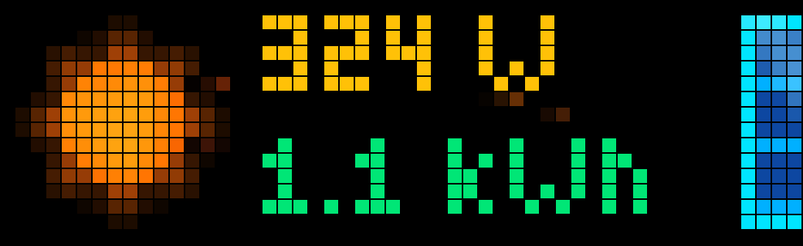
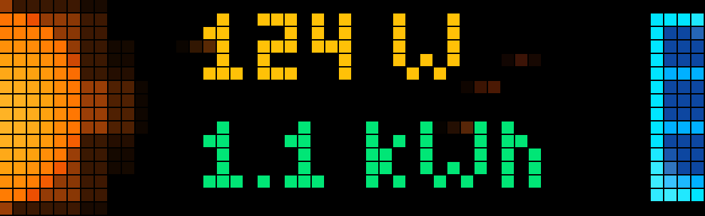
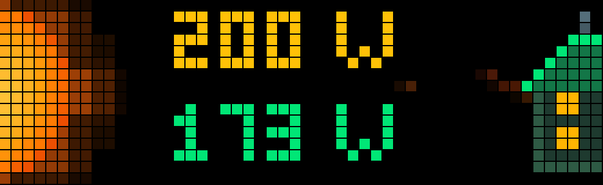
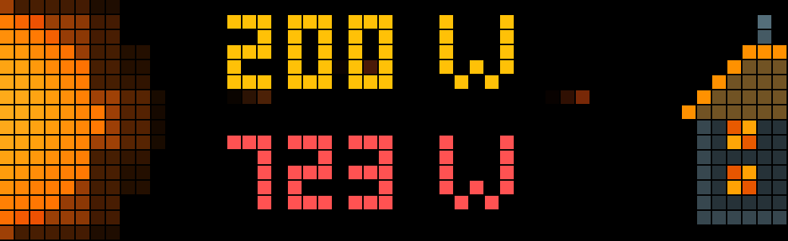

# ☀️ SolarApp – AWTRIX Solar & Energy Monitor (52×16)

[](Changelog.md)
[](https://github.com/Blueforcer/awtrix-light)
[-brightgreen.svg)]()
[-yellow.svg)]()
[](LICENSE)

An elegant, animated solar generation, daily yield, and live household energy monitor for **AWTRIX Light / AWTRIX NG** (specifically tailored for 52×16 LED displays such as the **Ulanzi TC002**).

Instead of displaying plain numbers, **SolarApp** turns your LED matrix into a living solar dashboard: a glowing pixel-art sun with realistic 3D spherical rotation, dynamic watt-scaled photon streams, and an interactive dual-view that switches seamlessly between your **Daily Solar Yield** and your **Live House Consumption**.

---

## 📸 Preview

### Visual Styles (Daily Yield View)
| ☀️ Style: `sun_large` (Full 16×16 3D Sun) | 🌅 Style: `sun_half` (XXL Rising Half-Sun) |
| :---: | :---: |
|  |  |
| *Full 16×16 3D rotating sun, flowing photons, and shimmering solar module.* | *Oversized half-sun rising along the left border with wide photon corridor.* |

<br>

### Interactive House Consumption View
| 🟢 Solar Surplus (`Production ≥ Consumption`) | 🔴 Grid Import (`Consumption > Production`) |
| :---: | :---: |
|  |  |
| *Green roof (`#00E676`), bright window flashes as photons enter the house.* | *Warm roof (`#FF9100`), red demand (`#FF5252`), cozy flickering hearth glow.* |

---

## ✨ Key Features

* **☀️ Dynamic 3D Sun Animation:**
  * Pixel-art sun with an 8-lobed pulsating corona and spherical 3D surface rotation.
  * Rotation speed dynamically scales in real time with your solar power output.
  * Automatic sleeping night mode at 0 W (gentle resting glow and dimmed telemetry).

* **✨ Flowing Photon Trails (Streaks):**
  * Subpixel-interpolated photon streaks (2–3 pixel fading trails) glide across the matrix.
  * Motion speed accelerates under peak generation (e.g. 800 W+) and slows gently during low-light hours.
  * Muted ember and terracotta hues (`#C2410C`–`#92400E`) designed to remain glare-free behind text.
  * In consumption mode, photons gracefully curve downward and are absorbed into the roof.

* **🔘 Interactive Hardware Button Toggle:**
  * Press the **Select button** (middle button on the clock) at any time to toggle between the **Daily Yield view** and the **House Consumption view**.
  * The active view is saved to flash memory (`active_view`) and automatically restored across app rotations and reboots.

* **🏡 Dynamic Pixel-Art House (Consumption Mode):**
  * **Solar Surplus:** Clean energy surplus illuminates the roof in vivid eco-green, with golden window flashes each time photons strike the home.
  * **Grid Import:** When house demand exceeds solar generation, the roof turns to warm amber/terracotta, the readout shifts to high-visibility coral-red (`#FF5252`), and the windows emit an organic, flickering hearth glow (`#E65100`–`#FFD54F`).

* **🟦 Shimmering Solar Panel (Yield Mode):**
  * Sleek 4-pixel wide pixel-art solar panel at the right edge (`x: 48..51`) featuring a cyan frame and deep-blue silicon cells.
  * Meditative, slow shimmer wave (~3.5 s cycle) breathing softly during power generation.

* **📊 Crystal-Clear Telemetry:**
  * **Line 1 (Top):** Live Solar Power in Watts displayed in warm golden yellow (`#FFC107`).
  * **Line 2 (Bottom - Yield View):** Total Daily Yield in eco-green (`#00E676`), automatically formatting into `Wh` or decimal `kWh`.
  * **Line 2 (Bottom - Consumption View):** Live Household Consumption in Watts, color-coded green (surplus) or coral-red (grid import).

* **⚡ Ultra-Optimized Performance:**
  * Zero-allocation render loop designed for minimal ESP32 CPU load and zero memory churn.
  * Fast native regex extraction avoids heavy JSON parsing overhead.

---

## 📡 MQTT Configuration & Payloads

SolarApp subscribes to up to three MQTT topics configured in the AWTRIX Web UI:

| Metric | Line / Screen | Default Topic | Expected Unit |
| :--- | :--- | :--- | :--- |
| **Solar Generation** | Line 1 (Top) | `inverter/total/P_AC` | Watts (W) |
| **Daily Solar Yield** | Line 2 (Yield View) | `inverter/total/YieldDay` | Watt-hours (Wh) |
| **House Consumption** | Line 2 (Consumption View) | `house/total/power` | Watts (W) |

### Supported Message Formats

The app handles both **raw numbers** and **JSON objects** natively.

#### 1. Plain Numbers / Raw Strings
Publish numeric strings directly:
```text
450
450.5
```

#### 2. JSON Payloads
SolarApp automatically extracts the appropriate value from JSON payloads:

* **Solar Power Topic (`topic_power`):**
  ```json
  {"production": 650}
  ```
  *Accepted keys:* `production`, `Production`, `P_AC`, `p_ac`, `power`, `Power`, `consumption`, `Consumption`, `solar_power`, `solar_production`, `P_PV`, `val`, `value`, `p`, `P`

* **Daily Yield Topic (`topic_yield`):**
  ```json
  {"YieldDay": 3200}
  ```
  *Accepted keys:* `YieldDay`, `yield`, `Yield`, `production`, `Production`, `daily_production`, `today_production`, `energy_today`, `yield_day`, `energy`, `Energy`, `val`, `value`, `y`, `E_Day`

* **House Consumption Topic (`topic_consumption`):**
  ```json
  {"consumption": 420}
  ```
  *Accepted keys:* `consumption`, `Consumption`, `power`, `Power`, `house_power`, `grid_power`, `load`, `Load`, `P_Load`, `p_load`, `total_power`, `act_power`, `apower`, `val`, `value`, `p`, `P`

---

## ⚙️ Configuration Options

All settings can be customized directly in the AWTRIX Web UI under the **Apps** tab by clicking the gear icon next to **SolarApp**:

| Setting | Type | Default | Description |
| :--- | :--- | :--- | :--- |
| **Visual Style** | Select | `sun_large` | Choose between `sun_large` (16×16 3D sun) or `sun_half` (XXL rising half-sun). |
| **Power MQTT Topic** | Text | `inverter/total/P_AC` | MQTT topic for live solar power generation (W). |
| **Daily Yield MQTT Topic** | Text | `inverter/total/YieldDay` | MQTT topic for today's solar yield (Wh). |
| **Consumption MQTT Topic** | Text | `house/total/power` | MQTT topic for live house consumption (W). |
| **Default Bottom View** | Select | `yield` | Default view for Line 2 (`yield` or `consumption`). Can be toggled on-the-fly via the hardware button. |
| **Max Power (W)** | Number | `800` | Inverter peak rating (e.g. 600, 800, 1500, 5000 W) to calibrate rotation and photon speeds. |
| **Animation Speed** | Number | `4` | Base pace (1–10) for rotation and shimmer effects. |
| **Yield Unit** | Select | `auto` | `auto` (switches to kWh above 1000 Wh), or force `kWh` / `Wh`. |

---

## 🚀 Installation

1. Open your AWTRIX Light / NG Web UI in your browser (e.g. `http://awtrix.local` or its local IP address).
2. Go to **Files** / **Dateimanager**.
3. Open the `/APPS/` directory.
4. Upload [`SolarApp.ax`](SolarApp.ax).
5. Switch to the **Apps** tab, configure your MQTT topics, and enjoy your new live solar dashboard!

---

## 📝 Changelog

Detailed release notes and version history can be found in [Changelog.md](Changelog.md).

---

## 📄 License

This project is open-source under the [MIT License](LICENSE).
